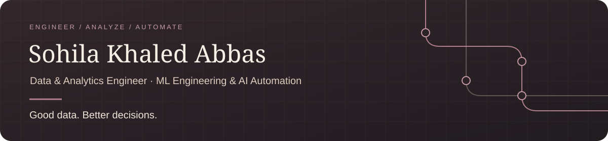
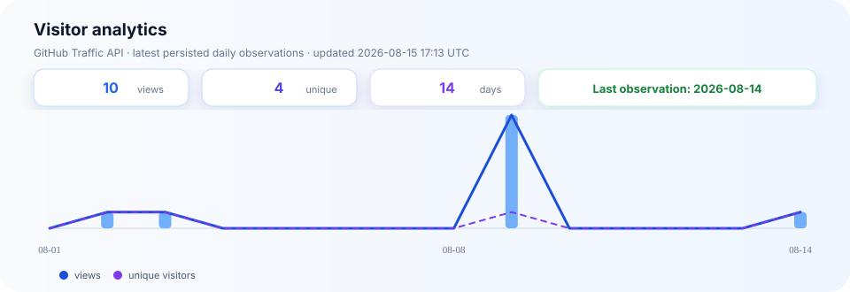

<!-- Generated profile README; source: templates/README.md + portfolio profile data. -->

# Sohila Khaled Abbas

### BI Developer · Data Analyst · Analytics Engineer

Damietta, Egypt · Open to remote collaboration

<strong>Nearly 2 years building BI solutions</strong> · Power BI dashboards · Reporting · Analytics projects

## Hey, I’m Sohila

I’m a BI Developer with nearly two years of freelance experience turning business questions into reliable Power BI dashboards and reporting. My work spans sales and retail performance, churn, supply chain, e-commerce, customer satisfaction, marketing, HR, and healthcare. I work from data preparation and validation through SQL and Power Query transformations, dimensional modeling, KPI definitions, and interactive report design—because the numbers behind a dashboard matter as much as the visuals.

I like starting with the question behind the numbers, checking whether the data deserves our trust, and only then deciding what the dashboard should say.

## What I work on

- **BI & reporting:** Power BI dashboards, DAX, Power Query, KPI design, and Excel reporting.
- **Analytics projects:** retail performance and churn, Egyptian Cosmetics, supply chain, customer support, and PixelFed.
- **Data & automation:** SQL, Python, dimensional modeling, ETL/ELT, Excel VBA, and workflow automation.

## Selected work

- **[B2B Retail Performance & Churn](https://github.com/Sohila-Khaled-Abbas/fmcg-sales-churn-drop-analysis-powerbi)** — Power BI reporting on retailer performance, churn, delivery SLAs, and commercial trends.
- **[Egyptian Cosmetics Analytics](https://github.com/Sohila-Khaled-Abbas/egyptian-cosmetics-market)** — Multi-source ELT, SQL Server dimensional warehouse, data-quality validation, and Power BI reporting.
- **[Forage Excel Skills Simulation](https://github.com/Sohila-Khaled-Abbas/forage-excel-skills-job-simulation)** — Excel formulas, data checks, PivotTables, dashboarding, and VBA macros.
- **[PixelFed Analytics Engineering](https://github.com/Sohila-Khaled-Abbas/pixelfed-analytics-engineering)** — An in-progress multi-format lakehouse and Power BI semantic model.
- **[n8n Workflow Automation](https://github.com/Sohila-Khaled-Abbas/n8n-production-queue-setup)** — Self-hosted queue-mode workflow infrastructure.

## Experience

- **Freelance BI Developer** · Dec 2024 – Present
- **Machine Learning Engineer Intern, FlyRank AI** · Jul 2026 – Sep 2026
- **Data Analysis Mentor, Data Pill** · Jul 2025 – Apr 2026
- **Freelancing Coach, DEPI** · Sep 2025 – Jun 2026

## The Data Tea ☕

I share practical notes, learning resources, and the thinking behind my work through **The Data Tea**. I believe good data work should be understandable, reusable, and useful beyond the person who built it.

## Tools I use

Power BI · Excel & VBA · SQL · Python · Power Query · DAX · ETL/ELT · Dimensional Modeling · Git & GitHub

<strong>GitHub activity & contribution animation</strong>

<picture>
  <source media="(prefers-color-scheme: dark)" srcset="./assets/github-snake-dark.svg" />
  <source media="(prefers-color-scheme: light)" srcset="./assets/github-snake.svg" />
  
</picture>

[Portfolio](https://sohila-khaled-abbas.vercel.app/) · [LinkedIn](https://linkedin.com/in/sohilakabbas) · [GitHub](https://github.com/Sohila-Khaled-Abbas)

---
Good data. Better decisions.
