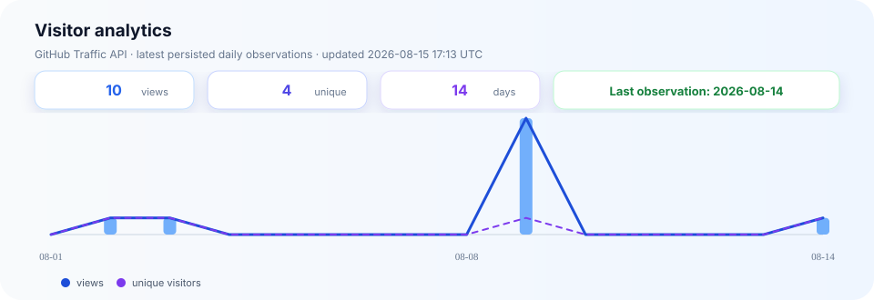

<!-- Generated by scripts/sync_profile.py. Edit this template, profile.config.json, or the portfolio content sources. -->

# Sohila Khaled Abbas

### Data &amp; Analytics Engineer · Machine Learning Engineer

Damietta, Egypt · Open to remote collaboration

I work across data and analytics engineering, machine learning, and business intelligence. My focus spans ETL/ELT pipelines, data warehousing, predictive modeling, and decision-ready reporting with Python, SQL, Power BI, Airflow, dbt, Databricks, and PySpark. My background in agricultural science and quality-focused research shapes how I approach validation, documentation, and evidence.

## What I build

- **Data foundations:** Python and SQL pipelines, ETL/ELT, validation, dimensional models, and warehouses.
- **Useful analytics:** Power BI semantic models, DAX, Power Query, Excel, and reporting that starts with a business question.
- **Automation & AI:** n8n workflows, API integrations, Docker queue stacks, and retrieval workflows.
- **Machine learning:** Feature engineering, predictive modeling, and model evaluation with Python.

## Currently building

- **[PixelFed Analytics Engineering](https://github.com/Sohila-Khaled-Abbas/pixelfed-analytics-engineering)** · **In progress** 
  Refining ingestion, data-quality rules, and the analytics model.
- **[n8n Queue &amp; Worker Stack](https://github.com/Sohila-Khaled-Abbas/n8n-production-queue-setup)** · **In progress** 
  Improving the queue stack, upgrade workflow, and operational documentation.

## Selected projects

- **[PixelFed Analytics Engineering](https://github.com/Sohila-Khaled-Abbas/pixelfed-analytics-engineering)** · **In progress** 
  Production-Grade Analytics Engineering Lakehouse, Multi-Format Ingestion Engine, and Power BI Semantic Model 
  [Project preview](https://sohila-khaled-abbas.vercel.app/projects/pixelfed-analytics-engineering/)

- **[Egyptian Cosmetics Analytics Engineering](https://github.com/Sohila-Khaled-Abbas/egyptian-cosmetics-market)** 
  Enterprise Multi-Source ELT, SQL Server 2022 Kimball Data Warehouse, SCD Type 2, Automated Data Quality Quarantine &amp; Power BI Analytics Lifecycle 
  [Project preview](https://sohila-khaled-abbas.vercel.app/projects/egyptian-cosmetics-market/)

- **[n8n Queue &amp; Worker Stack](https://github.com/Sohila-Khaled-Abbas/n8n-production-queue-setup)** · **In progress** 
  A production-grade, self-hosted n8n deployment with queue-mode scaling, PostgreSQL persistence, and an isolated Python/JavaScript code execution sidecar. 
  [Project preview](https://sohila-khaled-abbas.vercel.app/projects/n8n-production-queue-setup/) · [Website / report](https://sohila-khaled-abbas.github.io/n8n-production-queue-setup/)

- **[B2B Retail Analytics &amp; Churn](https://github.com/Sohila-Khaled-Abbas/fmcg-sales-churn-drop-analysis-powerbi)** 
  Real-time insights into retailer behavior, operational performance, and customer lifecycle across the Maxab distribution network in Egypt. 
  [Project preview](https://sohila-khaled-abbas.vercel.app/projects/fmcg-sales-churn-drop-analysis-powerbi/) · [Website / report](https://app.powerbi.com/view?r=eyJrIjoiNzE0MWUwYTgtZTlhZC00N2IxLWFmYzQtYmI2MzFkNjFhN2NjIiwidCI6IjI1Y2UwMjYxLWJiZDYtNDljZC1hMWUyLTU0MjYwODg2ZDE1OSJ9)

- **[Kickstarter Analytics Engineering](https://github.com/Sohila-Khaled-Abbas/kickstarter-analytics-engineering)** 
  End-to-end data pipeline and Power BI model for Kickstarter campaign analysis. 
  [Project preview](https://sohila-khaled-abbas.vercel.app/projects/kickstarter-analytics-engineering/)

- **[Forward Deployed Engineer Roadmap](https://github.com/Sohila-Khaled-Abbas/forward-deployed-engineer-roadmap)** 
  A personal 24-week Forward Deployed Engineer roadmap for Sohila: Python, SQL, BI, n8n, production AI, customer delivery, and portfolio projects. Interactive GitHub Pages website. 
  [Project preview](https://sohila-khaled-abbas.vercel.app/projects/forward-deployed-engineer-roadmap/) · [Website / report](https://sohila-khaled-abbas.github.io/forward-deployed-engineer-roadmap/)

## My toolkit

- **Data &amp; analytics engineering:** Python, SQL, ETL / ELT, Data warehousing, Dimensional modeling, SQL Server, PostgreSQL, Data validation, Kimball dimensional modeling, MySQL, SSIS, Informatica
- **Platforms &amp; orchestration:** Airflow, dbt, Databricks, PySpark, Docker, Git &amp; GitHub, Apache Spark, Apache Kafka, Snowflake, BigQuery
- **Machine learning &amp; modeling:** Predictive modeling, Machine learning, Feature engineering, Model evaluation, Pandas, scikit-learn, NumPy
- **Business intelligence &amp; automation:** Power BI, DAX, Power Query M, Excel, Power Pivot, n8n, REST APIs, Technical documentation, Obsidian, Macros / VBA, Notion, Data storytelling
- **Analytics applications &amp; visualization:** Streamlit, Plotly, Metabase, Excel charts
- **Statistical analysis &amp; research:** A/B testing, Hypothesis testing, Statistical modeling, OLS regression, R, Selenium

## Learning in the open

I document what I build and share practical notes through **The Data Tea**, roadmaps, and technical labs. My next focus connects analytics engineering with **Forward Deployed Engineering**, production AI, and search & ranking.

- **[Forward Deployed Engineering](https://sohila-khaled-abbas.github.io/forward-deployed-engineer-roadmap/)** — Customer discovery, application engineering, production AI, and delivery.
- **[Data Engineering Learning Roadmap](https://github.com/Sohila-Khaled-Abbas/data-engineering-learning-roadmap)** — SQL, Python, pipelines, data platforms, and engineering foundations.
- **[Operating systems labs](https://github.com/Sohila-Khaled-Abbas/fundamentals-of-operating-systems-labs)** — Processes, memory, concurrency, and systems practice.
- **[Excel Zero to Hero](https://sohila-khaled-abbas.github.io/COURSE-EXCEL-ZERO-TO-HERO/)** — Reusable learning materials for Excel and business analysis.

<strong>Background, experience & training</strong>

**B.Sc. in Agriculture Sciences, Horticulture and Landscaping** · Damietta University · Faculty of Agriculture · 2024

### Experience

- **Machine Learning Engineer Intern** · FlyRank AI · Jul 2026 – Sep 2026
- **Data Engineer Intern** · Data Pill · Mar 2026 – Aug 2026
- **Business Intelligence Developer** · Freelance · Dec 2024 – Present
- **Technical Coach** · Digital Egypt Pioneers Initiative \(DEPI\) · Sep 2025 – Jun 2026
- **Data Analytics Mentor** · Data Pill · Jul 2025 – Apr 2026

### Training

- **n8n Foundations Professional Certificate** · n8n Academy · 2026
- **Fundamentals of Networking for Effective Backend Design** · Udemy · Oct 2026
- **Data Analytics Diploma** · Ahmed Ali · Friendly Analysis · Mar – May 2026
- **Build with AI: Masr Edition** · Information Technology Institute \(ITI\) · May 2026
- **Python, APIs &amp; data-platform foundations** · 365 Data Science · Nov 2025
- **Power BI Desktop &amp; Power BI Service** · Maven Analytics · Oct 2025
- **SQL, Python, Excel &amp; data foundations** · IBM · edX · Oct 2025

[Full résumé](https://sohila-khaled-abbas.vercel.app/resume/) · [Courses &amp; credentials](https://sohila-khaled-abbas.vercel.app/credentials/)

## Latest project updates

- **[Forward Deployed Engineer Roadmap](https://github.com/Sohila-Khaled-Abbas/forward-deployed-engineer-roadmap)** · 2026-10-31 
  A personal 24-week Forward Deployed Engineer roadmap for Sohila: Python, SQL, BI, n8n, production AI, customer delivery, and portfolio projects. Interactive GitHub Pages website.

- **[apple-stock-market-analysis](https://github.com/Sohila-Khaled-Abbas/apple-stock-market-analysis)** · 2026-10-31 
  An end-to-end data engineering and analytics project analyzing historical Apple Inc. \(AAPL\) stock market data up to the present day, to extract actionable business insights and investment strategies.

- **[n8n Queue &amp; Worker Stack](https://github.com/Sohila-Khaled-Abbas/n8n-production-queue-setup)** · 2026-10-31 · **In progress** 
  A production-grade, self-hosted n8n deployment with queue-mode scaling, PostgreSQL persistence, and an isolated Python/JavaScript code execution sidecar.

- **[data-engineering-learning-roadmap](https://github.com/Sohila-Khaled-Abbas/data-engineering-learning-roadmap)** · 2026-10-30 
  A practical, self-paced roadmap for SQL, Python, analytics engineering, data pipelines, big data, and portfolio projects.

- **[PixelFed Analytics Engineering](https://github.com/Sohila-Khaled-Abbas/pixelfed-analytics-engineering)** · 2026-10-30 · **In progress** 
  Production-Grade Analytics Engineering Lakehouse, Multi-Format Ingestion Engine, and Power BI Semantic Model

Public repository updates, newest first. Dates are UTC; activity does not imply project completion.

<strong>Explore all 75 public original projects</strong>

- **[ab-testing-marketing-conversion](https://github.com/Sohila-Khaled-Abbas/ab-testing-marketing-conversion)** · [Website](https://docs.google.com/presentation/d/1eYQSaxsK_8GT6Tk2pK9gJVb26Nv7NPhj8ik92czk8vI/edit?slide=id.p1#slide=id.p1) 
  A/B testing project analyzing the impact of a marketing ad campaign on user conversions using Python, PostgreSQL, and Excel. Includes statistical tests \(Z-test, Chi-square\), data cleaning, SQL queries, and…

- **[ai-automation-roadmap](https://github.com/Sohila-Khaled-Abbas/ai-automation-roadmap)** · [Website](https://ai-automation-roadmap-psi.vercel.app) 
  An interactive learning roadmap for AI automation, featuring n8n and adjacent automation tools as structured data-tea products. · Built with Manus

- **[airbnb-amsterdam-analysis](https://github.com/Sohila-Khaled-Abbas/airbnb-amsterdam-analysis)** 
  An end-to-end data analytics project using PySpark, PostgreSQL, Power BI, and ML to analyze and predict Airbnb activity in Amsterdam.

- **[Airbnb_Athens_Analysis](https://github.com/Sohila-Khaled-Abbas/Airbnb_Athens_Analysis)** 
  A production analytics project across the complete data lifecycle: ingestion, warehousing, transformation, profiling, and storytelling. Using Airbnb Athens data \(September 2025 snapshot with 26,900+ listings\).

- **[apple-stock-market-analysis](https://github.com/Sohila-Khaled-Abbas/apple-stock-market-analysis)** · [Website](https://app.powerbi.com/view?r=eyJrIjoiNTNhYmI1ZjUtNDNhZC00OWM3LWFjYzktMmU0NWYyODYzZjIxIiwidCI6IjI1Y2UwMjYxLWJiZDYtNDljZC1hMWUyLTU0MjYwODg2ZDE1OSJ9) 
  An end-to-end data engineering and analytics project analyzing historical Apple Inc. \(AAPL\) stock market data up to the present day, to extract actionable business insights and investment strategies.

- **[AR_Financial_Tracking_System](https://github.com/Sohila-Khaled-Abbas/AR_Financial_Tracking_System)** 
  An end-to-end Accounts Receivable data engineering pipeline — synthetic data generation at scale \(950K+ records\), Power Query ETL transformation, Star Schema modeling, and collection follow-up simulation —…

- **[COURSE-EXCEL-ZERO-TO-HERO](https://github.com/Sohila-Khaled-Abbas/COURSE-EXCEL-ZERO-TO-HERO)** · [Website](https://sohila-khaled-abbas.github.io/COURSE-EXCEL-ZERO-TO-HERO/) 
  A production-grade Obsidian Knowledge System, Interactive Learning Web Platform, Data Analytics Curriculum, and GitHub Portfolio Repository for mastering modern Microsoft Excel, Power Query, Power Pivot, DAX,…

- **[customer-360-banking-etl](https://github.com/Sohila-Khaled-Abbas/customer-360-banking-etl)** 
  A production-grade multi-source ETL pipeline that consolidates banking, ATM, and credit card data into a single Customer 360 golden record, enforcing a strict three-rule exception matrix to quarantine…

- **[Customer-Churn-Analysis](https://github.com/Sohila-Khaled-Abbas/Customer-Churn-Analysis)** 
  This project delivers a complete data analytics pipeline for a fictional Telecom company, integrating:

- **[customer-segmentation-clustering](https://github.com/Sohila-Khaled-Abbas/customer-segmentation-clustering)** 
  This project demonstrates a full end-to-end data analytics pipeline: from raw e-commerce customer data → ETL → clustering → star schema → advanced SQL \(CTEs &amp; window functions\) → Power BI storytelling…

- **[data-career-roadmap-generator](https://github.com/Sohila-Khaled-Abbas/data-career-roadmap-generator)** · [Website](https://the-data-tea-roadmaps.vercel.app) 
  An end-to-end data engineering pipeline that scrapes real-time job market data across multiple platforms, extracts technical skills using Gemini 2.0 Flash, and powers an interactive Serverless Next.js web…

- **[data-engineering-learning-roadmap](https://github.com/Sohila-Khaled-Abbas/data-engineering-learning-roadmap)** 
  A practical, self-paced roadmap for SQL, Python, analytics engineering, data pipelines, big data, and portfolio projects.

- **[deep-clean-data-tool](https://github.com/Sohila-Khaled-Abbas/deep-clean-data-tool)** · [Website](https://deep-clean-os.streamlit.app) 
  DeepClean is a robust Python-based framework designed to automate the critical stages of the Data Engineering cleaning lifecycle. It is available as both a reproducible Python class for programmatic use and a…

- **[docker-hadoop](https://github.com/Sohila-Khaled-Abbas/docker-hadoop)** 
  Production-grade, fully configured Big Data environment for local development, education, and distributed processing.

- **[docker-workshop](https://github.com/Sohila-Khaled-Abbas/docker-workshop)** 
  Workshop Codespaces

- **[ecommerce-flash-sale-analysis](https://github.com/Sohila-Khaled-Abbas/ecommerce-flash-sale-analysis)** 
  A forensic data engineering investigation into how "Cyber Flash Drops" are silently destroying profit margins through deal-sniper users and coordinated bot exploitation.

- **[egyptian-cosmetics-market](https://github.com/Sohila-Khaled-Abbas/egyptian-cosmetics-market)** 
  Enterprise Multi-Source ELT, SQL Server 2022 Kimball Data Warehouse, SCD Type 2, Automated Data Quality Quarantine &amp; Power BI Analytics Lifecycle

- **[Emergency-Room-Dashboard](https://github.com/Sohila-Khaled-Abbas/Emergency-Room-Dashboard)** · [Website](https://app.powerbi.com/view?r=eyJrIjoiZjNmNjEwMzMtYzM3OS00OWM5LTkzYTUtNjJhODU2NTcxNzU3IiwidCI6IjI1Y2UwMjYxLWJiZDYtNDljZC1hMWUyLTU0MjYwODg2ZDE1OSJ9) 
  Power BI dashboard analyzing emergency room data to improve decision-making. Features advanced DAX measures, insights into patient satisfaction, visit trends, and demographics. Includes interactive design…

- **[employee-directory](https://github.com/Sohila-Khaled-Abbas/employee-directory)** 
  Build a structured SQL database + ERD for the Employee Directory dataset \(44 columns\). The goal is to normalize the flat file, reduce redundancy, and enable efficient queries for reporting, analytics, and…

- **[enterprise-hr-analytics](https://github.com/Sohila-Khaled-Abbas/enterprise-hr-analytics)** 
  A production-grade, enterprise data engineering &amp; business intelligence platform for Nexora Tech Solutions \(حلول نكسورا للبرمجيات\), transforming 6 heterogeneous HR, L&amp;D Academy, and Client Delivery source…

- **[Excel-VBA-Second-Brain](https://github.com/Sohila-Khaled-Abbas/Excel-VBA-Second-Brain)** 
  A personal knowledge system for mastering Excel VBA, Macros, Automation Architecture, Debugging, UserForms, and Office Suite Integration

- **[flyrank-ml-internship-starter](https://github.com/Sohila-Khaled-Abbas/flyrank-ml-internship-starter)** 
  Official portfolio, applied machine learning research paper, and autonomous decision-support agent for Sohila Khaled Abbas \(Applied ML Intern &amp; Search Intelligence Engineer at FlyRank AI \| BI Developer\).

- **[fmcg-sales-churn-drop-analysis-powerbi](https://github.com/Sohila-Khaled-Abbas/fmcg-sales-churn-drop-analysis-powerbi)** · [Website](https://app.powerbi.com/view?r=eyJrIjoiNzE0MWUwYTgtZTlhZC00N2IxLWFmYzQtYmI2MzFkNjFhN2NjIiwidCI6IjI1Y2UwMjYxLWJiZDYtNDljZC1hMWUyLTU0MjYwODg2ZDE1OSJ9) 
  Real-time insights into retailer behavior, operational performance, and customer lifecycle across the Maxab distribution network in Egypt.

- **[forward-deployed-engineer-roadmap](https://github.com/Sohila-Khaled-Abbas/forward-deployed-engineer-roadmap)** · [Website](https://sohila-khaled-abbas.github.io/forward-deployed-engineer-roadmap/) 
  A personal 24-week Forward Deployed Engineer roadmap for Sohila: Python, SQL, BI, n8n, production AI, customer delivery, and portfolio projects. Interactive GitHub Pages website.

- **[fundamentals-of-operating-systems-labs](https://github.com/Sohila-Khaled-Abbas/fundamentals-of-operating-systems-labs)** 
  An engineering-first, hands-on repository covering core operating system internals, process anatomy, virtual memory, CPU cache lines, socket buffers, page cache, and copy-on-write \(COW\).

- **[Fx-Rate-Pipeline](https://github.com/Sohila-Khaled-Abbas/Fx-Rate-Pipeline)** 
  An intentionally flawed ETL pipeline built with Apache NiFi and PostgreSQL inside Docker, designed to surface and demonstrate the architectural limitations of in-flight stateful transformation — and why the…

- **[global-horizon-bank-dwh-project](https://github.com/Sohila-Khaled-Abbas/global-horizon-bank-dwh-project)** · [Website](https://global-horizon-bank-dwh-project.streamlit.app/) 
  This repository contains the complete architecture and implementation of a data system for Global Horizon Bank. Following industry best practices, the project transitions from a highly normalized…

- **[global-layoffs-analysis](https://github.com/Sohila-Khaled-Abbas/global-layoffs-analysis)** 
  The Global Layoffs Analysis project uses SQL to explore workforce reduction trends across industries, funding stages, and regions. By analyzing clean and enhanced datasets, it uncovers key drivers of layoffs,…

- **[healthcare-analytics-dashboard](https://github.com/Sohila-Khaled-Abbas/healthcare-analytics-dashboard)** · [Website](https://app.powerbi.com/view?r=eyJrIjoiNDI1ODE0MmYtODk0YS00ZjcxLTgwZTgtODM1NzA0NThjZjEwIiwidCI6IjI1Y2UwMjYxLWJiZDYtNDljZC1hMWUyLTU0MjYwODg2ZDE1OSJ9) 
  Interactive Power BI dashboard for analyzing hospital waitlists, patient demographics, and service trends.

- **[hive-scd2-datapill-lab](https://github.com/Sohila-Khaled-Abbas/hive-scd2-datapill-lab)** 
  Data Engineering Diploma \(Data Pill Academy\) - Big Data Lab 2: Hive Internal vs. External Tables &amp; Non-Transactional SCD Type 2 Architecture

- **[HR-Analytics-Dashboard](https://github.com/Sohila-Khaled-Abbas/HR-Analytics-Dashboard)** · [Website](https://app.powerbi.com/view?r=eyJrIjoiMTgxZTY2NmMtNzA5ZS00Y2FlLWIxNzgtMDM2MWY0ZTIzZjczIiwidCI6IjI1Y2UwMjYxLWJiZDYtNDljZC1hMWUyLTU0MjYwODg2ZDE1OSJ9) 
  Interactive Power BI dashboard for HR analytics, providing actionable insights into employee attendance and leave patterns. Features dynamic filters, DAX measures, and visually engaging reports for…

- **[hr-analytics-hub](https://github.com/Sohila-Khaled-Abbas/hr-analytics-hub)** 
  An advanced, serverless Single-Page Application \(SPA\) built on Google Apps Script. This tool empowers HR professionals to upload raw CSV datasets, processes the data entirely in-memory \(client-side\) for…

- **[IMDB-Top250-Movies-Dashboard](https://github.com/Sohila-Khaled-Abbas/IMDB-Top250-Movies-Dashboard)** · [Website](https://app.powerbi.com/view?r=eyJrIjoiMWJlYmY2ODgtYzQwOS00NzY5LWJmZWItMWI0N2Q0MTJkYmI1IiwidCI6IjI1Y2UwMjYxLWJiZDYtNDljZC1hMWUyLTU0MjYwODg2ZDE1OSJ9) 
  Explore cinema trends with the IMDB Top 250 Movies Dashboard, a Power BI project that visualizes movie ratings, distributions, and top-performing films. The dashboard uses interactive visualizations, advanced…

- **[job-scraper](https://github.com/Sohila-Khaled-Abbas/job-scraper)** 
  Crawl job listings for a search \(e.g., "data analyst", Cairo\) from Indeed, extract structured fields, store into SQLite, keep deduped &amp; incremental updates.

- **[kafka-cluster](https://github.com/Sohila-Khaled-Abbas/kafka-cluster)** 
  A production-ready, 3-broker Apache Kafka cluster with ZooKeeper, designed for Big Data &amp; Spark Structured Streaming integration.

- **[kickstarter-analytics-engineering](https://github.com/Sohila-Khaled-Abbas/kickstarter-analytics-engineering)** 
  End-to-end data pipeline and Power BI model for Kickstarter campaign analysis.

- **[local_data_aggregator](https://github.com/Sohila-Khaled-Abbas/local_data_aggregator)** 
  Transform your disparate CSV and Excel files into unified, actionable intelligence.

- **[marketing-campaign-dashboard](https://github.com/Sohila-Khaled-Abbas/marketing-campaign-dashboard)** 
  Source files and documentation for Marketing Campaign Dashboard.

- **[marketing_campaigns_analysis](https://github.com/Sohila-Khaled-Abbas/marketing_campaigns_analysis)** 
  This project explains how data engineering and analytics enable smarter campaign investments. Optimizing marketing spend requires reliable, well-modeled data. We build an end-to-end pipeline from raw campaign…

- **[MaxAB_B2B_Retail_Wallet_Optimization](https://github.com/Sohila-Khaled-Abbas/MaxAB_B2B_Retail_Wallet_Optimization)** 
  This project audits the operational efficiency and financial viability of wallet recharge mechanisms for MaxAB, a B2B retail platform. By ingesting raw operational logs and transaction data into a Databricks…

- **[n8n-production-queue-setup](https://github.com/Sohila-Khaled-Abbas/n8n-production-queue-setup)** · **In progress** · [Website](https://sohila-khaled-abbas.github.io/n8n-production-queue-setup/) 
  A production-grade, self-hosted n8n deployment with queue-mode scaling, PostgreSQL persistence, and an isolated Python/JavaScript code execution sidecar.

- **[n8n-workflow-apple-rag-chatbot-v2](https://github.com/Sohila-Khaled-Abbas/n8n-workflow-apple-rag-chatbot-v2)** 
  Autonomous RAG chatbot indexing Apple 10-K filings and products using OpenAI embeddings, Qdrant vector store, and conversational memory with hybrid reranking.

- **[n8n-workflow-daily-viral-content-radar](https://github.com/Sohila-Khaled-Abbas/n8n-workflow-daily-viral-content-radar)** 
  Automated trend monitoring pipeline scraping viral content, extracting engagement metrics, classifying topics via AI, and generating daily digest reports.

- **[n8n-workflow-delivery-telegram-bot](https://github.com/Sohila-Khaled-Abbas/n8n-workflow-delivery-telegram-bot)** 
  Interactive Telegram delivery bot with natural language cart management, LangChain agent, OpenRouter inference, and MSSQL session state persistence.

- **[n8n-workflow-emaar-towers-lead-qualification](https://github.com/Sohila-Khaled-Abbas/n8n-workflow-emaar-towers-lead-qualification)** 
  Real estate AI lead qualification agent evaluating buyer budgets, property preferences, and down payment readiness with OpenRouter LLM, CRM logging, and agent routing.

- **[n8n-workflow-gdrive-pdf-qdrant-indexer](https://github.com/Sohila-Khaled-Abbas/n8n-workflow-gdrive-pdf-qdrant-indexer)** 
  Event-driven ETL pipeline monitoring Google Drive for PDFs, extracting and chunking text, generating embeddings, and upserting vectors into Qdrant for RAG.

- **[n8n-workflow-gourmet-bistro-customer-service](https://github.com/Sohila-Khaled-Abbas/n8n-workflow-gourmet-bistro-customer-service)** 
  Multi-agent LangChain restaurant assistant with Qdrant/Supabase RAG, Google Sheets dynamic pricing, order management with 5-min grace cancellation, and Telegram kitchen dispatch.

- **[n8n-workflow-gpt-oss-20b-huggingface](https://github.com/Sohila-Khaled-Abbas/n8n-workflow-gpt-oss-20b-huggingface)** 
  Cloud LLM inference workflow integrating HuggingFace API with automatic 503 cold-start retries, Wait node backoff, and robust response parsing.

- **[n8n-workflow-sentiment-analysis-agent](https://github.com/Sohila-Khaled-Abbas/n8n-workflow-sentiment-analysis-agent)** 
  Real-time customer feedback sentiment classifier logging sentiment scores to Google Sheets and triggering instant priority alerts for negative reviews.

- **[n8n-workflow-telegram-notion-etl](https://github.com/Sohila-Khaled-Abbas/n8n-workflow-telegram-notion-etl)** 
  Content curation pipeline extracting links and media from Telegram, generating AI summaries with key takeaways, and persisting structured entries in Notion.

- **[n8n-workflow-upwork-ai-proposal-creator](https://github.com/Sohila-Khaled-Abbas/n8n-workflow-upwork-ai-proposal-creator)** 
  Automated lead generation pipeline scraping Upwork jobs via Apify, evaluating client requirements with GPT-4, and generating tailored freelance proposals.

- **[national-insurance-data-warehouse](https://github.com/Sohila-Khaled-Abbas/national-insurance-data-warehouse)** 
  An end-to-end data pipeline and warehouse solution for managing and analyzing synthetic Egyptian National Insurance data \(specifically Form 5 records\). This repository covers the complete lifecycle of data,…

- **[nl2sql_pipeline](https://github.com/Sohila-Khaled-Abbas/nl2sql_pipeline)** 
  A production-ready, secure Natural Language to SQL \(NL2SQL\) pipeline using Python, LangChain, and SQLAlchemy.

- **[novatel-big-data-ecosystem](https://github.com/Sohila-Khaled-Abbas/novatel-big-data-ecosystem)** 
  This project specifically addresses the "High Write Velocity" problem in telecom, where traditional databases fail during peak events \(e.g., Ramadan, football matches\).

- **[O-List-E-Commerce-Data-Analytics](https://github.com/Sohila-Khaled-Abbas/O-List-E-Commerce-Data-Analytics)** 
  A comprehensive Data Engineering and Business Intelligence solution analyzing the Brazilian E-Commerce Public Dataset by Olist.

- **[pixelfed-analytics-engineering](https://github.com/Sohila-Khaled-Abbas/pixelfed-analytics-engineering)** · **In progress** 
  Production-Grade Analytics Engineering Lakehouse, Multi-Format Ingestion Engine, and Power BI Semantic Model

- **[Portfolio](https://github.com/Sohila-Khaled-Abbas/Portfolio)** · [Website](https://sohila-khaled-abbas.github.io/Portfolio/) 
  This repository contains the code and assets for my personal portfolio website. It serves as a professional hub where visitors can explore my data analysis projects, skills, and get in touch with me. The site…

- **[pwc-switzerland-virtual-case](https://github.com/Sohila-Khaled-Abbas/pwc-switzerland-virtual-case)** 
  PwC Switzerland Virtual Case Experience: Enterprise Business Intelligence, Ralph Kimball Galaxy Semantic Model \(VertiPaq Engine\), DAX KPI Engineering &amp; Executive Excel Application Architecture

- **[Python_EDA_Case_Study](https://github.com/Sohila-Khaled-Abbas/Python_EDA_Case_Study)** 
  This project is an implementation of exploratory data analysis \(EDA\) techniques in Python, inspired by Mustafa Othman's YouTube tutorial. It focuses on analyzing employee salary data to uncover trends and…

- **[regional-sales-dashboard](https://github.com/Sohila-Khaled-Abbas/regional-sales-dashboard)** · [Website](https://github.com/Sohila-Khaled-Abbas/regional-sales-dashboard) 
  Power BI dashboard for analyzing regional sales trends, identifying growth opportunities, and increasing profitability by 20% using actionable insights.

- **[remote-work-tracker](https://github.com/Sohila-Khaled-Abbas/remote-work-tracker)** 
  Daily scrape remote job postings, ingest into SQL, expose cleansed dataset to Power BI for trend analysis and data-driven business recommendations.

- **[ride-sharing-kafka-pipeline](https://github.com/Sohila-Khaled-Abbas/ride-sharing-kafka-pipeline)** 
  Production-grade event streaming pipeline with automated orchestration, idempotent production, at-most-once consumption, and high-throughput topic architecture.

- **[S-OP_Dashboard](https://github.com/Sohila-Khaled-Abbas/S-OP_Dashboard)** 
  An enterprise-grade Omnichannel Sales &amp; Operations Planning \(S&amp;OP\) Dashboard built with Microsoft Power BI. This repository leverages the new Power BI Project \(.pbip\) format and Tabular Model Definition…

- **[SMART-Supply-Chain-Insights-Dashboard](https://github.com/Sohila-Khaled-Abbas/SMART-Supply-Chain-Insights-Dashboard)** · [Website](https://app.powerbi.com/view?r=eyJrIjoiNzc1YzdkYWQtZDlkZC00MDhkLWJhNGEtZDg4YzRmMDI5NTljIiwidCI6IjI1Y2UwMjYxLWJiZDYtNDljZC1hMWUyLTU0MjYwODg2ZDE1OSJ9) 
  A comprehensive end-to-end data analytics project using Python, Excel, and Power BI to extract actionable insights from complex supply chain data. This dashboard supports operational and strategic…

- **[Social-Media-Advertising-Dashboard](https://github.com/Sohila-Khaled-Abbas/Social-Media-Advertising-Dashboard)** · [Website](https://app.powerbi.com/view?r=eyJrIjoiMTRlM2M4OWQtMTcyYy00YzhjLWE3NDAtZGNmMDkxNTUwYzIwIiwidCI6IjI1Y2UwMjYxLWJiZDYtNDljZC1hMWUyLTU0MjYwODg2ZDE1OSJ9) 
  This repository contains a comprehensive Power BI dashboard for analyzing social media advertising campaigns. It includes data cleaning with Python, exploratory visualizations, and a multi-page Power BI…

- **[sohila-data-showcase](https://github.com/Sohila-Khaled-Abbas/sohila-data-showcase)** · [Website](https://sohilakhaled-portfolio.lovable.app/) 
  Personal Data Portfolio Website

- **[sohila-k-abbas-website](https://github.com/Sohila-Khaled-Abbas/sohila-k-abbas-website)** · [Website](https://sohila-khaled-abbas.vercel.app/) 
  This repository contains the source code for a personal data portfolio website built for Sohila Khaled Abbas — a recognized BI Developer, Data Analytics Engineer, and Top 200 Arabic-Speaking Influencer in…

- **[sql-server-data-platform](https://github.com/Sohila-Khaled-Abbas/sql-server-data-platform)** · [Website](https://sohila-khaled-abbas.github.io/sql-server-data-platform/) 
  This repository serves as an operational codebase and architectural proof of competency for modern Data Engineering &amp; Database Reliability Engineering \(DBRE\) on Microsoft SQL Server 2022. It is engineered…

- **[Startup-Expansion-Analysis-Dashboard](https://github.com/Sohila-Khaled-Abbas/Startup-Expansion-Analysis-Dashboard)** · [Website](https://app.powerbi.com/view?r=eyJrIjoiZTFiMTFjOWQtNjI5Ni00YzRiLWEwNzQtZmVlZjM2OGQwZGZlIiwidCI6IjI1Y2UwMjYxLWJiZDYtNDljZC1hMWUyLTU0MjYwODg2ZDE1OSJ9) 
  This project integrates Python and Power BI to analyze a startup's store expansion performance. It features a 5-page interactive dashboard covering revenue, ROI, marketing efficiency, and detailed store-level…

- **[Stock-Price-Data-Pipeline](https://github.com/Sohila-Khaled-Abbas/Stock-Price-Data-Pipeline)** 
  An end-to-end automated data pipeline built with Apache Airflow, Apache Spark, MinIO, PostgreSQL, and Metabase.

- **[streampulse](https://github.com/Sohila-Khaled-Abbas/streampulse)** 
  Live Netflix Catalog &amp; Audience Intelligence ELT Pipeline

- **[the-data-tea](https://github.com/Sohila-Khaled-Abbas/the-data-tea)** 
  The Data Tea is an interactive, community-driven career guidance portal for aspiring data professionals. It helps anyone — from total beginners to mid-career switchers — discover which data career path fits…

- **[world-economy-bi-project](https://github.com/Sohila-Khaled-Abbas/world-economy-bi-project)** 
  A data-driven one-page report on the state of the global economy using World Bank and UN HDI datasets.

- **[Wuzzuf-Job-Market-Analysis](https://github.com/Sohila-Khaled-Abbas/Wuzzuf-Job-Market-Analysis)** · [Website](https://app.powerbi.com/view?r=eyJrIjoiMGNjZmFlOWItMWU3My00ZjM4LTlhYjQtMWY5N2QzOGQwMTAyIiwidCI6IjI1Y2UwMjYxLWJiZDYtNDljZC1hMWUyLTU0MjYwODg2ZDE1OSJ9) 
  Wuzzuf Job Market Analysis is a Power BI Dashboard that analyzes job market trends in Egypt using web scraping and data analytics. This project extracts job postings from Wuzzuf.net, cleans the data, and…

- **[yfinance-project](https://github.com/Sohila-Khaled-Abbas/yfinance-project)** 
  End-to-end Finance Analytics solution

## Activity

<strong>Contribution metrics & animations</strong>

<picture>
  <source media="(prefers-color-scheme: dark)" srcset="./assets/github-snake-dark.svg" />
  <source media="(prefers-color-scheme: light)" srcset="./assets/github-snake.svg" />
  
</picture>

## Let’s build something useful

Open to remote projects in **business intelligence, data & analytics engineering, and workflow automation**.

[Explore my portfolio](https://sohila-khaled-abbas.vercel.app/) · [Connect on LinkedIn](https://linkedin.com/in/sohilakabbas) · [Email me](mailto:sohila.k.data@gmail.com)

---

Bio, toolkit, training, project statuses, and public projects sync hourly from my portfolio and GitHub. [How the automation works](docs/PROFILE_AUTOMATION.md) · [Refresh workflow](https://github.com/Sohila-Khaled-Abbas/Sohila-Khaled-Abbas/actions/workflows/sync-profile.yml)
